# 📊 台灣餐飲業 2015–2024：總體產值與個體營運分析
> 基於五大部會開放資料與三層式 Python ETL 管線之產業結構與財務可行性實證研究

**📜 License:** MIT | **💻 Data Engine:** Python (Pandas / SQLite) | **📈 Visualization:** Tableau

---

### 📌 專案分析結論 (TL;DR)
微型餐飲因缺乏規模經濟，在固定成本上升與市場集中的趨勢下，面臨較高的營運風險。單店淘汰率不僅受經營者個體能力影響，亦與整體成本結構及競爭型態高度相關。

👉 [**點擊進入：Tableau 線上互動式視覺化儀表板**](https://public.tableau.com/app/profile/guanying.lin/viz/V320152024_17925689929200/sheet34)

---

## 1. 專題論證架構與核心提問 (Research Framework)

本研究採三階段遞進論證架構，結合總體經濟指標與個體稅籍財報，解構台灣餐飲業十年結構變遷：

* **【第一階段：成本面檢驗】核心提問：餐飲業的核心營業成本是否逐年加重？**
  * 母體稅籍結構（73.83% 免稅小規模營業人）與歷年三大營運成本佔比（食材 46.01%、人事 26.53%、租金 5.47%）。
  * 成本率與淨利率之負向關聯、業者痛點調查（食材波動 65.6%、人力高漲 51.1%）、法定基本工資十年調幅（時薪累計調升 +59.1%，月薪 +42.5%）。
* **【第二階段：收益面檢驗】核心提問：帳面營業額創新高，是否代表實質消費量擴大？**
  * 月度名目營業額長期趨勢（+27.77%）與食物類消費者物價指數走勢（+12.75%）。
  * 物價平減後之實質營業額歸因：逾半數成長來自終端售價調升，2023 至 2024 年轉呈「價漲量縮」（名目微增 +0.42%，實質營業額衰退 -1.37%）。
* **【第三階段：市場分配與淘汰結果】核心提問：破兆元產值流向何處？個體戶最終存續狀態為何？**
  * 營業稅門檻約束與壓力測試：常態下高達 61% 至 87% 之產業總營收，集中於佔比僅 26.17% 之應稅一般營業人。
  * 六大上市櫃集團本土營收版圖（474.6 億元）與集中度（僅佔應稅家數 0.015%，卻囊括 6.17% 應稅市場總營收；單一上市集團年營收約當 434 家一般應稅業者總和）。
  * 十年期月度歇業淘汰曲線：2020 年 7 月後，單月平均歇業數由前期 539 家攀升至 682 家（增幅達 +26.6%），顯示個體退場規模受結構性因素驅動而擴張。

---

## 2. 官方資料來源與 Python ETL 處理架構 (System Architecture)

本系統採用「原始資料唯讀隔離 (Immutability)」與「三層式 ETL 管線」架構。五大機關開放資料集皆透過 Python 自動化腳本完成清洗、物價平減與門檻推估，最終同步匯流至 `SQLite` 關聯式資料庫與 Tableau 視覺化成品區。

### 🔄 全系統資料血緣與 ETL 流向圖 (Data Lineage)

```mermaid
graph LR
    subgraph S1["Step 1：五大部會原始資料來源 (Raw Data)"]
        direction TB
        M1_RAW["主計總處 XML / 經濟部 CSV<br/>(跨格式時間序列與基期對齊)"]
        M2_RAW["經濟部餐飲業經營實況調查報告 PDF<br/>(17 份異質 PDF，存在跨年表號漂移與統計期落差)"]
        M3_RAW["勞動部基本工資 CSV<br/>(不定期離散公告文字，非連續序列)"]
        M4_RAW["財政部 171萬筆稅籍 / 商業司 CSV<br/>(檔案龐大、混雜非餐飲代碼與雜訊)"]
        M6_RAW["證交所 MOPS 6 份財報 HTML<br/>(網頁標籤嵌套、含海外子公司營收)"]
    end

    subgraph S2["Step 2：Python 核心資料工程與清洗技術 (ETL Processing)"]
        direction TB
        M1_PROC["模組一 (m1)：<br/>xml.etree 樹狀結構解析<br/>+ pivot_table 樞紐分析與2021基期實質平減除算"]
        M2_PRE["前置作業 (00_rename)：<br/>歷年表號與統計調查年特徵比對<br/>+ 17 份非結構化 PDF 規範化重命名"]
        M2_PROC["模組二 (m2)：<br/>PDF 空間分詞與特徵錨定<br/>+ 跨年問卷題號位移分支路由<br/>+ 剛性成本與利潤率時序正規化"]
        M3_PROC["模組三 (m3)：<br/>Regex 非結構化數值萃取<br/>+ merge_asof 非同步時序對齊與ffill 前向填充 (120 個月)"]
        M4_PRE["前置作業 (00_inspect)：<br/>nrows=3 輕量結構探勘<br/>+ 欄位綱要檢驗與型態安全門禁"]
        M4_PROC["模組四 (m4)：<br/>chunksize=50000 流式分塊載入<br/>+ 行業代號 56 純化在營餐飲母體與歇業家數整理"]
        M5_PROC["模組五 (m5)：<br/>營業稅法法定門檻 (20萬)<br/>與 實務營收區間(10萬下限 / 30萬上限容差)情境壓力建模"]
        M6_PROC["模組六 (m6)：<br/>MOPS 財報 HTML 結構解析<br/>與台灣境內營收權重校正<br/>+ 跨模組結算資本集中度"]
    end

    subgraph S3["Step 3：標準化資料庫與視覺化實證 (Production Ready)"]
        direction TB
        M1_VIEW["T01-T03: 宏觀名目/實質平減 (m1)"]
        M2_VIEW["T05-T06: 剛性成本與營運困境 (m2)"]
        M3_VIEW["T07: 基本工資 120個月序列 (m3)"]
        M4_VIEW["T09-T10: 歇業趨勢與稅籍母體 (m4)"]
        M5_VIEW["T04: 帕累托門檻壓力測試 (m5)"]
        M6_VIEW["T08: 上市集團財報與資本寡占結構 (m6)"]
        FINAL["catering_analysis.sqlite<br/>(11 份標準化 _clean.csv 同步入庫)<br/>──────────────────────<br/>交付 Tableau 進行三階段實證可視化"]
    end

    %% 資料血緣連線 (Data Lineage)
    M1_RAW --> M1_PROC --> M1_VIEW --> FINAL
    M2_RAW --> M2_PRE --> M2_PROC --> M2_VIEW --> FINAL
    M3_RAW --> M3_PROC --> M3_VIEW --> FINAL
    M4_RAW --> M4_PRE --> M4_PROC --> M4_VIEW --> FINAL
    M4_PROC -->|T10 稅籍母體快照| M5_PROC --> M5_VIEW --> FINAL
    M6_RAW --> M6_PROC
    M5_PROC -->|"T04 應稅市場營收總盤 (分母)"| M6_PROC --> M6_VIEW --> FINAL

    %% 容器背景與外框
    style S1 fill:#0f172a,stroke:#64748b,stroke-width:1.5px,color:#f8fafc
    style S2 fill:#020617,stroke:#3b82f6,stroke-width:2px,color:#f8fafc
    style S3 fill:#022c22,stroke:#10b981,stroke-width:2px,color:#f8fafc

    %% Step 1 原始資料來源
    style M1_RAW fill:#1e293b,stroke:#64748b,stroke-width:1.5px,color:#f8fafc
    style M2_RAW fill:#1e293b,stroke:#64748b,stroke-width:1.5px,color:#f8fafc
    style M3_RAW fill:#1e293b,stroke:#64748b,stroke-width:1.5px,color:#f8fafc
    style M4_RAW fill:#1e293b,stroke:#64748b,stroke-width:1.5px,color:#f8fafc
    style M6_RAW fill:#1e293b,stroke:#64748b,stroke-width:1.5px,color:#f8fafc

    %% 前置作業節點 (灰底虛線)
    style M2_PRE fill:#1c1917,stroke:#78716c,stroke-dasharray: 4 2,stroke-width:1.5px,color:#e7e5e4
    style M4_PRE fill:#1c1917,stroke:#78716c,stroke-dasharray: 4 2,stroke-width:1.5px,color:#e7e5e4

    %% Step 2 核心清洗模組
    style M1_PROC fill:#082f49,stroke:#0ea5e9,stroke-width:2px,color:#e0f2fe
    style M2_PROC fill:#331a00,stroke:#f97316,stroke-width:2px,color:#ffedd5
    style M3_PROC fill:#330a0a,stroke:#ef4444,stroke-width:2px,color:#fee2e2
    style M4_PROC fill:#330a0a,stroke:#ef4444,stroke-width:2px,color:#fee2e2
    style M5_PROC fill:#330a0a,stroke:#ef4444,stroke-width:2px,color:#fee2e2
    style M6_PROC fill:#082f49,stroke:#0ea5e9,stroke-width:2px,color:#e0f2fe

    %% Step 3 成品交付
    style M1_VIEW fill:#064e3b,stroke:#22c55e,stroke-width:1.5px,color:#f0fdf4
    style M2_VIEW fill:#064e3b,stroke:#22c55e,stroke-width:1.5px,color:#f0fdf4
    style M3_VIEW fill:#064e3b,stroke:#22c55e,stroke-width:1.5px,color:#f0fdf4
    style M4_VIEW fill:#064e3b,stroke:#22c55e,stroke-width:1.5px,color:#f0fdf4
    style M5_VIEW fill:#064e3b,stroke:#22c55e,stroke-width:1.5px,color:#f0fdf4
    style M6_VIEW fill:#064e3b,stroke:#22c55e,stroke-width:1.5px,color:#f0fdf4
    style FINAL fill:#042f2e,stroke:#38bdf8,stroke-width:2px,color:#f0fdf4

    %% 導線色彩設定
    linkStyle default stroke:#38bdf8,stroke-width:2px
```



### 📁 專案目錄拓樸架構 (Project Topology)
```text
Taiwan-Catering-Industry-2015-2024/
├── README.md                                   # 專案分析總覽、ETL 溯源總表與執行說明
├── 資料來源/ (Raw Data - 5大政府機關原始檔案，唯讀不修改)
│   ├── m1/ T03_消費者物價指數.xml (dataset/8237)
│   ├── m2/ 經濟部餐飲業經營實況調查報告 (menu_id=9431)：表9成本結構 (8份PDF)、營運困境表 (9份PDF)
│   ├── m3/ 勞動部最低基本工資制定與調整經過.csv (dataset/6281)
│   ├── m4/ 財政部全國營業稅籍登記.csv (dataset/9400)、商業署月度歇業家數統計.csv (dataset/29268)
│   └── m6/ 證交所公開資訊觀測站 (MOPS t164sb04)：六大上市櫃餐飲集團合併綜合損益表 (6份HTML)
│
└── py/ (Source Code & Database - 9支標準化 Python ETL 腳本與 SQLite 資料庫)
    ├── catering_analysis.sqlite                # 關聯式資料庫 (集中儲存 10 張標準化 _clean 成品資料表)
    ├── T01_T02_T03_m1_etl_revenue_and_cpi.py   # [Level 1] 解析 CPI 與名目營收，執行物價平減 (產出 P9-P11)
    ├── 00_rename_m2_survey_pdfs.py             # [Pre-ETL] 批次標準化調查報告 PDF 命名與年份對齊
    ├── T05_T06_m2_load_survey_data.py          # [Level 1] 萃取三大成本率與營運困境比例 (產出 P5-P7)
    ├── T07_m3_etl_minimum_wage.py              # [Level 1] 解析基本工資公告並展開 120 個月序列 (產出 P8)
    ├── 00_inspect_m4_registry.py               # [Pre-ETL] 探勘全國稅籍底冊之欄位結構
    ├── T09_T10_m4_etl_registry_and_closings.py # [Level 1] 分塊篩選 56 餐飲母體與月度歇業序列 (產出 P4, P15)
    ├── T04_m5_calc_pareto_stress_test.py       # [Level 2] 依賴 T10 母體與營業稅門檻執行營收分配推估 (產出 P12)
    ├── T08_m6_parse_listed_groups_financials.py# [Level 1] 解析六大集團財報並乘算台灣事業群營收權重 (產出 P13)
    ├── T08_m6_calc_capital_monopoly.py         # [Level 3] 依賴 T04 與 T08_1 結算集團市場佔有率 (產出 P14)
    └── 成品/ (Processed Clean Data - 供 Tableau 直連繪圖之 11 份乾淨 CSV 檔案)
        └── T01 ~ T10 標準化 _clean.csv
```

---

## 3. 研究結論與營運變數分析：微型餐飲之商業模式評估

### 一、 三階段論證之數據收斂
1. **[第一階段 - 成本面] 核心營業成本比重與調幅上升**：食材成本（年均 46.01%）與人事支出（年均 26.53%，法定時薪十年調升 +59.1%）佔總營收逾七成，且與營業利益率呈負向連動，直接壓縮單店獲利空間。
2. **[第二階段 - 收益面] 實質消費量呈現停滯**：十年間名目營業額成長（+27.77%）逾半源於終端售價調升，扣除食物類物價因素後，近期實質營業額轉呈衰退（2024 年 -1.37%）。
3. **[第三階段 - 市場分配與淘汰] 營收集中伴隨個體退場規模擴大**：推估逾 61% 之產業營收集中於 26.17% 之應稅營業人；在市場集中與成本上升背景下，住宿及餐飲業之個體行號退場規模擴大（後期月均歇業達 682 家，較前期增加 +26.6%），顯示淘汰趨勢受制於上述結構性因素，非單一疫情週期所能解釋。

### 二、 行銷與營運調整之侷限
當佔全台母體 73.83% 之免稅小規模營業人面臨上述成本與市場結構限制時，若僅增加行銷預算、促銷折讓或依賴高抽成之外送平台，將進一步增加費用支出，無法實質降低核心營業成本。

### 三、 微型創業之財務可行性變數
微型餐飲之商業計畫可行性，取決於創業初期對**「食材」**與**「人事」**兩大變數之控制方案：
* **人事成本控制變數（人力配置極簡化）**：考量基本工資連續調升，微型店家需透過營運流程設計（如：去服務化動線、自助點餐機制、精簡備料工序），降低對外部人力的依賴程度，確保人事成本維持於合理營收佔比內。
* **食材耗損控制變數（產品線收斂）**：由於微型單店缺乏聯合採購議價能力，需透過精簡菜單品項（SKU 收斂）、提高共用食材率與半成品耗損控制，以穩定食材成本率，確保長期存續之財務空間。

---
## 4. 附錄：官方原始資料來源與 ETL 溯源總表 (Data Governance)

為維持資料工程之審計軌跡與可驗證性，本專案提供完整之「五大部會原始資料清冊」與「全模組 ETL 延伸溯源表」。

👉 📊 **[點擊開啟：線上公開完整版 ETL 溯源與資料治理試算表 (Google Sheets)](https://docs.google.com/spreadsheets/d/1NGXTpjD4F5hliJCM73f-_YXu_pQgJCzZQPGIvaMUyEoq4/edit?usp=sharing)**  
*(建議透過線上試算表檢視，享有完整欄寬延展、凍結表頭與直覺之試算體驗)*

---

<details>
<summary><b>🔍 點擊展開：表一、官方原始資料來源清冊 (Data Sources Catalog)</b></summary>

<br>

| 序號 | 對應模組與圖表 | 資料集或系統名稱 | 來源機關 | 資料格式 | 官方平臺規格代碼 | 官方平臺驗證連結 | 主要資料欄位與內容說明 |
| :---: | :--- | :--- | :--- | :---: | :--- | :---: | :--- |
| **1** | 模組一 (T03 原生 / T01 延伸) | 消費者物價特殊分類指數 | 行政院主計總處 | XML | 政府資料開放平臺 dataset/8237 | [連結](https://data.gov.tw/dataset/8237) | 包含總指數（不含食物、不含蔬果及能源等核心物價）之每月原始值與年增率（%），基期為民國110年=100。 |
| **2** | 模組一 (T02 原生 / T01 延伸) | 批發、零售及餐飲業營業額指數 | 經濟部統計處 | CSV | 批發、零售及餐飲業營業額指數 CSV | [連結](https://data.gov.tw/dataset/16365) | 包含批發、零售及餐飲業各大類與中分類之每月營業額指數，基期為民國110年=100。 |
| **3** | 模組一 (T02 詮釋資料) | 統計處批發、零售及餐飲業營業額指數 | 經濟部 | 網頁 / API | 政府資料開放平臺 dataset/16365 | [連結](https://data.gov.tw/dataset/16365) | 序號2之資料集在政府開放平臺上的詮釋資料(Metadata)與介接說明頁面，主要欄位包含行業代碼、行業別、資料期、統計值及計量單位。 |
| **4** | 模組二 (T05_1、T06 原生 / T05_2 延伸) | 批發、零售及餐飲業經營實況調查報告 | 經濟部統計處 | 網頁 / PDF | 經濟部統計處 menu_id=9431 | [連結](https://www.moea.gov.tw/Mns/dos/content/ContentLink.aspx?menu_id=9431) | 涵蓋歷年批發、零售及餐飲業之營運收支（表9）、固定資產增購、商品銷售流向、進貨來源及經營困境等實況調查與提要分析數據。 |
| **5** | 模組三 (T07 原生) | 最低(基本)工資之制定與調整經過 | 勞動部 | CSV / JSON | 政府資料開放平臺 dataset/6281 | [連結](https://data.gov.tw/dataset/6281) | 記錄我國最低工資制定與調整之歷史沿革，主要欄位包含序號、西元年度、西元發布日期、調整金額(新台幣)與西元實施日期。 |
| **6** | 模組四 (T10 原生) / 模組五 (T04 延伸) / 模組六 (T08_2 延伸) | 全國營業(稅籍)登記資料集 | 財政部財政資訊中心 | CSV (壓縮檔) | 政府資料開放平臺 dataset/9400 | [連結](https://data.gov.tw/dataset/9400) | 全國營運中企業之稅籍資料，欄位含統一編號、營業人名稱、資本額、設立日期、組織別、使用統一發票、營業地址及多組行業代號與名稱。 |
| **7** | 模組六 (T08_1 原生 / T08_2 延伸) | 公開資訊觀測站 (合併綜合損益表) | 臺灣證券交易所 | 系統 / HTML | 公開資訊觀測站 MOPS (t164sb04) | [連結](https://mopsov.twse.com.tw/mops/web/t164sb04) | 台灣上市、上櫃、興櫃及公開發行公司之重大訊息、營收、財務報表（113年第4季合併綜合損益表）、董監持股等公開法定資訊查詢系統。 |
| **8** | 模組四 (T09 原生) | 商業登記歇業家數－按行業分 | 經濟部商業發展署 | CSV | 政府資料開放平臺 dataset/29268 | [連結](https://data.gov.tw/dataset/29268) | 記錄全國各行業別每月歇業解散登記家數，主要擷取欄位為年月別、住宿及餐飲業家數。 |

</details>

<br>

<details>
<summary><b>🔍 點擊展開：表二、全專案 ETL 模組延伸溯源總表 (Data Lineage & Audit Log)</b></summary>

<br>

| 故事頁碼 | 圖表編號 | ETL 層級 | 對應模組 | 對應執行腳本 (`py/`) | 資料來源分類與模組延伸溯源 | 官方驗證連結 | 本地原始資料規格 (`資料來源/`) | 產出檔案 (`py/成品/`) | 關鍵欄位 (Features) | 核心商業邏輯與稽核重點 |
| :---: | :---: | :---: | :---: | :--- | :--- | :---: | :--- | :--- | :--- | :--- |
| **P4** | T10 | Level 1 | 模組四 | `T09_T10_m4_etl_registry_and_closings.py`<br>*(前置: `00_inspect_m4_registry.py`)* | 【原生資料】財政部：全國營業(稅籍)登記資料集 (dataset/9400) | [驗證](https://data.gov.tw/dataset/9400) | `m4/T10_m4_raw_active_registry_snapshot_raw.csv` | `T10_m4_active_registry_snapshot_clean.csv` | `統一編號`, `營業人名稱`, `行業代號`, `設立日期`, `使用統一發票` | **母體結構篩選**：篩選 56 餐飲業代碼，計算在營母體中免稅小規模營業人（73.83%）與一般營業人（26.17%）之比例。 |
| **P5** | T05_1 | Level 1 | 模組二 | `T05_T06_m2_load_survey_data.py`<br>*(前置: `00_rename_m2_survey_pdfs.py`)* | 【原生資料】經濟部：批發、零售及餐飲業經營實況調查報告 (menu_id=9431) | [驗證](https://www.moea.gov.tw/Mns/dos/content/ContentLink.aspx?menu_id=9431) | `m2/2015~2024_m2_cost_structure_raw.pdf` (共 8 份 PDF) | `T05_m2_chart_cost_structure_annual_clean.csv` | `year`, `revenue`, `cogs`, `wage_expense`, `rent_expense`, `operating_profit`, `cogs_ratio`, `wage_ratio`, `rent_ratio`, `profit_margin` | **成本結構計算**：正規化食材 (46.01%)、人事 (26.53%)、租金 (5.47%) 三大成本率，建立平均營業利益率區間（2016、2021 普查年留空）。 |
| **P6** | T05_2 | Level 1 | 模組二_延伸 | `T05_T06_m2_load_survey_data.py` | 【延伸自模組二 T05_1】底層來源：經濟部經營實況調查報告 (menu_id=9431) | [驗證](https://www.moea.gov.tw/Mns/dos/content/ContentLink.aspx?menu_id=9431) | 共用模組二 T05_1 之 8 份成本結構 PDF 原始檔 | `T05_m2_chart_cost_structure_annual_clean.csv` | `year`, `cogs_ratio`, `wage_ratio`, `rent_ratio`, `profit_margin` | **相關性檢驗**：直接引用模組二 T05_1 產出，計算食材、人事與租金成本率對營業利益率之線性關聯。 |
| **P7** | T06 | Level 1 | 模組二 | `T05_T06_m2_load_survey_data.py` | 【原生資料】經濟部：批發、零售及餐飲業經營實況調查報告 (menu_id=9431) | [驗證](https://www.moea.gov.tw/Mns/dos/content/ContentLink.aspx?menu_id=9431) | `m2/2016~2024_m2_operating_obstacles_raw.pdf` (共 9 份 PDF) | `T06_m2_chart_operating_obstacles_annual_clean.csv` | `year`, `obs_ingredient_fluctuation`, `obs_high_rent`, `obs_high_wage` | **營運困境數據清理**：清理官方複選題統計，擷取食材成本波動與人力成本高漲等項目之歷年回報比例。 |
| **P8** | T07 | Level 1 | 模組三 | `T07_m3_etl_minimum_wage.py` | 【原生資料】勞動部：最低(基本)工資之制定與調整經過 (dataset/6281) | [驗證](https://data.gov.tw/dataset/6281) | `m3/T07_m3_minimum_wage_monthly_raw.csv` | `T07_m3_chart_minimum_wage_monthly_clean.csv` | `year_month`, `min_wage_monthly`, `min_wage_hourly` | **法定工資序列彙整**：建立月薪與時薪調整序列，執行前向填充 (ffill) 產出 120 個月連續數值與基期指數。 |
| **P9** | T02 | Level 1 | 模組一 | `T01_T02_T03_m1_etl_revenue_and_cpi.py` | 【原生資料】經濟部：批發、零售及餐飲業營業額指數 (dataset/16365) | [驗證](https://data.gov.tw/dataset/16365) | `m1/T02_m1_catering_revenue_monthly_raw.csv` | `T02_m1_catering_revenue_monthly_clean.csv` | `year_month`, `catering_revenue_index`, `data_status` | **營業額指數萃取**：擷取官方月度餐飲業營業額指數（基期 2021=100），計算十年期名目指數變化。 |
| **P10** | T03 | Level 1 | 模組一 | `T01_T02_T03_m1_etl_revenue_and_cpi.py` | 【原生資料】主計總處：消費者物價特殊分類指數 (dataset/8237) | [驗證](https://data.gov.tw/dataset/8237) | `m1/T03_m1_macro_cpi_monthly_raw.xml` | `T03_m1_macro_cpi_monthly_clean.csv` | `year_month`, `cpi_total`, `cpi_core_index`, `cpi_food_related`, `data_status` | **物價指數對齊**：取出總指數與食物類關聯指數，以 2021=100 為基準，產出 120 個月序列。 |
| **P11** | T01 | Level 1 | 模組一_延伸 | `T01_T02_T03_m1_etl_revenue_and_cpi.py` | 【延伸自模組一 T02 與 T03】經濟部營業額指數 ＋ 主計總處 CPI | [驗證](https://data.gov.tw/dataset/16365) | 衍生除算（模組一 T02 營業額指數 除以 T03 物價指數） | `T01_m1_chart_real_vs_nominal_revenue_clean.csv` | `year_month`, `catering_revenue_index`, `cpi_total`, `cpi_food_related`, `real_revenue_index_calc`, `food_real_revenue_index_calc` | **實質營業額平減運算**：執行物價平減（T02 營業額指數 ÷ T03 食物類物價指數），分離名目營收增長與實質消費量變化。 |
| **P12** | T04 | Level 2 | 模組五 | `T04_m5_calc_pareto_stress_test.py` | 【延伸自模組四 T10 與模組二 T05_1】財政部全國稅籍 ＋ 經濟部大盤總營收 | [驗證](https://data.gov.tw/dataset/9400) | 衍生推估（依賴模組四 T10 母體與營業稅法門檻） | `T04_m5_chart_pareto_stress_test_2024_clean.csv` | `scenario`, `exempt_pct`, `invoice_pct`, `exempt_count`, `invoice_count`, `note` | **營收分配情境推算**：依賴 T10 母體數量與營業稅法 20 萬門檻（含 10 萬下限與 30 萬上限容差），推估免稅與應稅營業人之營收佔比。 |
| **P13** | T08_1 | Level 1 | 模組六 | `T08_m6_parse_listed_groups_financials.py` | 【原生資料】證交所：公開資訊觀測站－合併綜合損益表 (MOPS t164sb04) | [驗證](https://mopsov.twse.com.tw/mops/web/t164sb04) | `m6/2024_六大集團_income_statement_raw.html` (共 6 份 HTML) | `T08_m6_chart_listed_groups_financials_clean.csv` | `year`, `company_code`, `company_name`, `market_segment`, `research_task`, `tw_revenue_weight`, `revenue_mil`, `operating_profit_mil` | **上市櫃集團財報解析**：解析 6 大集團財報，乘上台灣事業群權重，結算本土營收規模與營業利益率。 |
| **P14** | T08_2 | Level 3 | 模組六_延伸 | `T08_m6_calc_capital_monopoly.py` | 【延伸自模組五 T04 與模組六 T08_1】財政部全國稅籍 ＋ 公開資訊觀測站 | [驗證](https://mopsov.twse.com.tw/mops/web/t164sb04) | 終端結算（依賴模組五 T04 應稅營收大盤 與 模組六 T08_1 集團台灣營收） | `T08_v2_chart_capital_monopoly_clean.csv` | `Metric`, `Category`, `Value_Pct`, `Label_Text` | **企業營收集中度結算**：依賴 T04 應稅營收大盤與 T08_1 台灣營收，計算大型連鎖集團於應稅市場之營收佔比。 |
| **P15** | T09 | Level 1 | 模組四 | `T09_T10_m4_etl_registry_and_closings.py` | 【原生資料】經濟部商業發展署：商業登記歇業家數－按行業分 (dataset/29268) | [驗證](https://data.gov.tw/dataset/29268) | `m4/T09_m4_chart_catering_closings_monthly_raw.csv` | `T09_m4_chart_catering_closings_monthly_clean.csv` | `year_month`, `catering_closings_count` | **歇業家數時序彙整**：擷取每月歇業解散登記家數，計算十年累計歇業量與前後階段月均變動。 |

</details>
